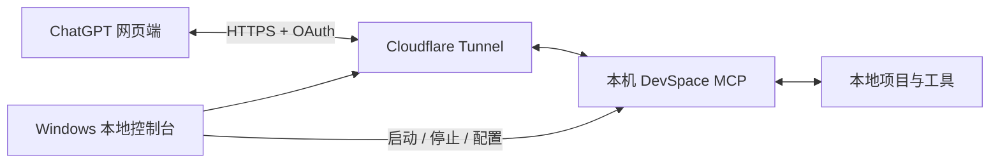

# ChatGPT Local Bridge｜ChatGPT 本地桥

**让 ChatGPT 网页端，直接访问并操作你的本地项目。**

读取文件、修改代码、运行命令、执行测试，把对话里的想法落实到电脑上的真实文件。

ChatGPT Local Bridge 是一个开源的 Windows 本地连接控制台。它通过 **DevSpace MCP + Cloudflare Tunnel**，将 ChatGPT 网页端与你授权的本地项目连接起来，并提供图形化的启动、停止、目录授权和连接诊断。

*Connect ChatGPT web to your local files, projects, and tools.*

[开始使用](docs/SETUP.md) · [故障排查](docs/TROUBLESHOOTING.md) · [撤销授权](docs/REVOKE.md)

## 能做什么

连接并授权后，你可以在 ChatGPT 网页对话中使用本地工具，完成从查看项目到修改、运行和验证的工作。

| 能力 | 可以怎样使用 |
| --- | --- |
| **读取本地文件** | 查看项目源码、配置、文档与文本数据，结合实际文件分析问题。 |
| **搜索项目内容** | 浏览目录，按文件名或内容查找函数、配置项和相关实现。 |
| **创建与修改文件** | 编写代码、修复问题、更新文档，将修改直接保存到本地项目。 |
| **执行本地命令** | 使用电脑上已安装的 Python、Node.js、Git 等命令行工具。 |
| **运行测试与构建** | 执行项目现有的测试、检查和构建命令，依据真实输出继续处理问题。 |
| **检查修改结果** | 查看文件变更与 Git 差异，了解具体改了什么，再决定下一步。 |

例如，你可以在选中连接的 ChatGPT 对话中提出：

> “先阅读这个项目的目录结构，解释主要模块的用途。”
>
> “修复这个函数的问题，把修改写回本地，并运行现有测试。”
>
> “整理 docs 目录中的使用说明，然后列出修改了哪些文件。”

文件与命令工具由 DevSpace 提供；本项目负责把连接、权限配置和日常运行管理整合到本地控制台。具体任务还取决于 ChatGPT 的工具支持、项目依赖和电脑上已安装的软件。

## 为什么使用本地桥

- **直接处理真实项目**：读取当前文件、把修改写回原项目，再使用本机环境验证结果，减少反复上传文件和复制粘贴。
- **桥接层不设调用配额**：本项目不额外设置每日或每月工具调用次数，也不按次收费。ChatGPT 平台自身的消息与工具额度、Cloudflare 服务规则及本机资源限制仍然适用。
- **无需额外模型 API Key**：使用 ChatGPT 网页端现有的模型与对话能力，这套桥接流程不要求另购模型 API Key。
- **复用现有开发环境**：沿用本机的项目、依赖与命令行工具，适合代码维护、文档整理、脚本运行和测试验证。
- **开源、可自行部署**：采用 MIT 许可证，源码和部署步骤公开，连接由你自己的电脑与 Cloudflare 隧道提供。

## 本地控制台提供什么

| 功能 | 说明 |
| --- | --- |
| **连接管理** | 启动、停止和重启控制台管理的 DevSpace 与 Cloudflare Tunnel。 |
| **项目目录授权** | 通过系统文件夹选择器添加或移除项目，保存后应用并重启，使新配置生效。 |
| **分层连接诊断** | 分别检查本地服务、隧道、公网 HTTPS、OAuth 发现与 MCP 认证保护，帮助定位断连原因。 |
| **托盘运行** | 关闭窗口后继续在托盘运行，可随时恢复窗口或停止连接。 |
| **异常恢复与运行记录** | 服务异常退出后有限重试，每项服务在 10 分钟内最多重试 3 次；记录保存在本机，日志大小受限。 |
| **撤销网页授权** | 撤销当前运行目录内的全部 OAuth 客户端授权，使旧访问令牌和刷新令牌失效。 |

默认从一个空测试目录开始授权，其他项目由你自行添加。当前采用手动启动，电脑重启后需要重新打开控制台并启动连接。

## 工作方式



DevSpace 监听本机回环地址，Cloudflare Named Tunnel 提供固定 HTTPS 入口。完成 OAuth 授权后，ChatGPT 通过 MCP 发起操作，并接收执行结果。

## 开始使用

你需要：

| 项目 | 要求 |
| --- | --- |
| 电脑 | Windows 10/11，x64；连接期间保持开机、联网并运行服务。 |
| ChatGPT | 账号与所在组织允许添加自定义 MCP / 应用。 |
| 域名与隧道 | Cloudflare 管理的域名、可用子域名与 cloudflared。 |
| 本地依赖 | Node.js `>=22.19 <27`（推荐 Node 24 LTS）、Git for Windows / Git Bash。 |
| DevSpace | **`@waishnav/devspace@1.0.8`**，需单独安装。 |

**当前仅兼容 DevSpace 1.0.8。** 其他版本可能使用不同配置格式，请勿直接替换。依赖检查、隧道授权和初始化步骤见[完整安装指南](docs/SETUP.md)。

获取源码并安装控制台依赖：

```powershell
git clone https://github.com/azuremgd/chatgpt-local-bridge.git
cd chatgpt-local-bridge
npm ci
```

按[安装指南](docs/SETUP.md)完成本机初始化、Cloudflare 隧道与 DNS 配置后，启动控制台：

```powershell
npm start
```

点击“启动连接”并检查状态，然后在 ChatGPT 网页端添加自己的 MCP 地址：

```text
https://devspace.example.com/mcp
```

将示例域名替换为自己的域名，完成 OAuth 授权，再用空测试目录验证一次实际工具调用。首次打开控制台本身不会自动开放已有项目。

## 权限与数据

**远程文件操作和命令执行具有真实权限。** 目录白名单用于管理项目访问，但不能限制 Shell 的全部访问能力；Shell 以运行 DevSpace 的 Windows 账户权限执行。建议使用专用的非管理员账户，并仅授予所需项目的系统权限。

连接保留 **Owner Password + OAuth** 认证。你可以停止连接、调整目录授权，或在设置中撤销全部网页授权；调整目录后需要应用并重启，改密码不能代替撤销已有令牌。

远程调用时，工具参数、读取的文件内容和命令输出可能经 Cloudflare 传递给 ChatGPT。控制台本身不添加遥测或自动日志上传。

更多说明：[安全模型](SECURITY.md) · [数据流与隐私](PRIVACY.md) · [授权撤销与恢复](docs/REVOKE.md)。

## 开发与打包

```powershell
npm test
npm run test:desktop
npm run package
```

桌面程序生成在 `dist/chatgpt-local-bridge-0.1.1-win32-x64/`。请保留整个目录，按安装指南配置后运行其中的 `ChatGPT Local Bridge.exe`。构建输出包含 Electron 运行时；Node.js、DevSpace、Git Bash 和 cloudflared 仍需单独安装。

重新构建时可以使用 `npm run package -- reviewed` 生成独立输出目录。打包过程不会复制本机运行配置、凭证、日志或项目内容。

参与开发请阅读 [CONTRIBUTING.md](CONTRIBUTING.md)。

## 致谢与许可

本项目是独立社区项目，与 OpenAI、Cloudflare 或 DevSpace 官方无隶属关系。本地 MCP 能力由 [Waishnav / DevSpace](https://github.com/Waishnav/devspace) 提供，公网连接使用 [Cloudflare Tunnel](https://github.com/cloudflare/cloudflared)。

本项目代码与应用图标采用 [MIT 许可证](LICENSE)。第三方组件保留各自的许可证，详见 [THIRD_PARTY_NOTICES.md](THIRD_PARTY_NOTICES.md)。
