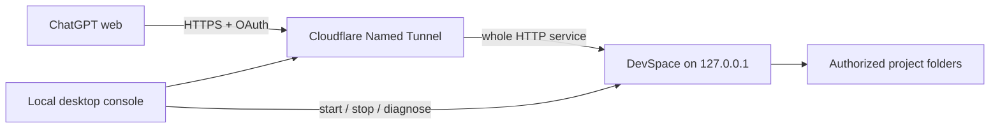

# ChatGPT Local Bridge｜ChatGPT 本地桥

**Connect ChatGPT web to your local projects and tools.**

A local Windows control panel for **ChatGPT web → Cloudflare Named Tunnel → DevSpace MCP → explicitly authorized project folders**.

**让 ChatGPT 网页端连接你的本地项目与工具。**

在 Windows 本地启动连接、选择授权项目、检查连通状态，并在需要时撤销网页授权。使用 DevSpace MCP 与 Cloudflare Named Tunnel，保留 Owner Password 和 OAuth 认证。

> Independent community project. Not an official OpenAI, Cloudflare, or DevSpace product. DevSpace is developed by [Waishnav](https://github.com/Waishnav/devspace).



## Features

- Start, stop and restart the two processes owned by the console.
- Separate local health, tunnel process state, public HTTPS, OAuth discovery and unauthenticated MCP protection checks.
- Native folder picker, explicit authorization confirmation, and saved versus loaded permission states.
- System tray operation; closing the window keeps the connection running.
- Bounded crash recovery: at most three retries per service in ten minutes.
- Local event history; no console telemetry or automatic log upload.
- Private runtime ACL and path checks, first-start Shell acknowledgement, bounded raw logs and explicit OAuth revocation.
- Keeps Owner Password, OAuth and an exact Host allowlist. No public administration endpoint and no automatic startup registration.

## Compatibility

| Component | Supported baseline |
| --- | --- |
| OS | Windows 10/11, x64 |
| Node.js | `>=22.19 <27`; Node 24 LTS recommended |
| DevSpace | **`@waishnav/devspace@1.0.8` only** |
| Cloudflare | `cloudflared`, locally managed named tunnel with a credentials file |
| UI runtime | Electron 45.0.0, pinned in the lockfile |

The console currently supports DevSpace 1.0.8's flat `config.json` schema. Newer upstream documentation uses a different `config.jsonc` schema; do not assume interchangeability. Upgrade support requires a reviewed migration. DevSpace, Node.js, Git Bash and cloudflared are installed separately and are not bundled with this repository.

## Quick start

Read [完整安装与连接指南](docs/SETUP.md) first. You need a Cloudflare-managed domain, a free hostname, and a ChatGPT account with custom MCP/app support.

```powershell
npm ci
npm test
npm start
```

First launch does **not** authorize any existing folder or expose a service. Complete the local setup described in the guide, then reopen the console. The default private runtime folder is `%USERPROFILE%\DevSpaceBridge`; it is separate from this checkout and from the normal `~/.devspace` installation.

To build an unpacked desktop application:

```powershell
npm run package
```

The result is `dist/chatgpt-local-bridge-0.1.1-win32-x64/`. Keep that directory together. It includes `Setup.ps1`, `Create-Shortcut.ps1` and the desktop executable. Packaging explicitly copies source assets, never the user's runtime configuration, logs, project contents or credentials. It does not create or upload a release and refuses to overwrite an existing build.

For a subsequent build, use a distinct output suffix, for example `npm run package -- reviewed`. This leaves existing builds intact and creates `dist/chatgpt-local-bridge-0.1.1-reviewed-win32-x64/`.

`npm run test:desktop` executes the real Electron main entry in a fresh private runtime. Pass a packaged executable to `node tests/desktop-smoke.cjs` to test the package. The OAuth integration test additionally requires `BRIDGE_TEST_DEVSPACE_CLI` pointing to a separately installed 1.0.8 CLI. A fresh runtime on an existing machine is not a clean-Windows installation test, and neither test proves an actual ChatGPT OAuth login/tool call.

## Security and privacy

**DevSpace grants remote coding capability. Its shell runs with the Windows user's authority. A folder allowlist is not a shell sandbox.** Prefer a dedicated non-administrator Windows account with access only to the projects you intend to share.

Read [SECURITY.md](SECURITY.md) and [PRIVACY.md](PRIVACY.md) before enabling access. OAuth must remain enabled. Proxy the complete HTTP service, including OAuth routes outside `/mcp`. The console intentionally refuses to stop unrelated/external processes.

Use `npm run privacy` after staging the exact files intended for commit. This scans the Git index for common secret formats, runtime files and image metadata; it is a review aid, not a security guarantee. Also inspect commit authors, history, filenames and all assets before making a repository public.

## Project layout

| Path | Purpose |
| --- | --- |
| `main.cjs`, `preload.cjs` | Electron window, tray and restricted local IPC |
| `service.cjs` | Process lifecycle, diagnostics and directory configuration |
| `installation.cjs`, `core.cjs` | Installation validation, minimal child environment, path and status rules |
| `ui/`, `assets/` | Chinese interface and application icons |
| `scripts/` | Explicit setup, source-only packaging and privacy checks |
| `tests/` | Folder boundaries, setup, redaction and service lifecycle regression tests |

Contributions: see [CONTRIBUTING.md](CONTRIBUTING.md). Operational help: [docs/TROUBLESHOOTING.md](docs/TROUBLESHOOTING.md).

## License

This project's code and application icon are offered under [MIT](LICENSE). Upstream components retain their own licenses; see [THIRD_PARTY_NOTICES.md](THIRD_PARTY_NOTICES.md). The icon was created with AI assistance and refined for Windows icon sizes. No third-party logos or private screenshots are included.
