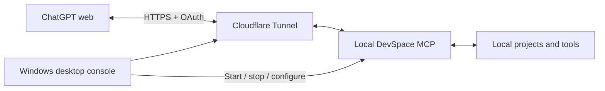

# ChatGPT Local Bridge

<p align="center">
  <a href="./README.md"><sub>EN</sub> English</a>
  &nbsp;·&nbsp;
  <a href="./README.zh-CN.md"><sub>CN</sub> 简体中文</a>
</p>

**Let ChatGPT web access and work with your local projects.**

Read files, edit code, run commands, and execute tests—turn ideas from a conversation into changes on your computer.

ChatGPT Local Bridge is an open-source Windows control panel that connects ChatGPT web to local projects you authorize through **DevSpace MCP + Cloudflare Tunnel**. It brings connection management, project access, and diagnostics into a desktop interface.

[Get started](docs/SETUP.md) · [Troubleshooting](docs/TROUBLESHOOTING.md) · [Revoke access](docs/REVOKE.md)

The console interface and the three guides above are currently in Chinese. This README includes the original button labels where needed.

## What you can do

Once connected and authorized, use local tools from your ChatGPT web conversation to inspect, edit, run, and verify work in your projects.

| Capability | Example uses |
| --- | --- |
| **Read local files** | Inspect source code, configuration, documentation, and text data to understand a project using its actual files. |
| **Search a project** | Browse directories and find functions, settings, or implementations by filename or file contents. |
| **Create and edit files** | Write code, fix bugs, and update documentation, saving changes directly to the local project. |
| **Run local commands** | Use command-line tools already installed on your computer, such as Python, Node.js, and Git. |
| **Run tests and builds** | Execute the project's existing tests, checks, and build commands, then use their real output to continue the task. |
| **Review changes** | Inspect file changes and Git diffs to understand what changed before deciding what to do next. |

For example, select the connection in a ChatGPT conversation and ask:

> “Read this project's directory structure and explain what the main modules do.”
>
> “Fix the issue in this function, save the changes locally, and run the existing tests.”
>
> “Improve the usage documentation in the docs folder, then list the files you changed.”

DevSpace provides the file and command tools. This project manages the connection, access configuration, and day-to-day operation. Individual tasks also depend on ChatGPT's tool support, project dependencies, and the software installed on your computer.

## Why use Local Bridge?

- **Work with real projects**: Read current files, save edits directly to the project, and verify them in your local environment, with less repeated uploading and copying between tools.
- **No bridge-imposed usage quota**: This project imposes no daily or monthly tool-call quota and charges no per-call fee. ChatGPT's own message and tool limits, Cloudflare's service rules, and local resource limits still apply.
- **No additional model API key**: Use the models and conversations available through ChatGPT web. This bridge does not require a separate model API key.
- **Reuse your development environment**: Keep using your local projects, dependencies, and command-line tools for code maintenance, documentation, scripts, and testing.
- **Open source and self-hosted**: The source and deployment instructions are public under the MIT license. Your computer and Cloudflare tunnel provide the connection.

## What the desktop console provides

| Feature | Description |
| --- | --- |
| **Connection controls** | Start, stop, and restart the DevSpace and Cloudflare Tunnel processes managed by the console. |
| **Project access management** | Add or remove projects with the native folder picker. Save, apply, and restart to load the updated configuration. |
| **Connection diagnostics** | Check the local service, tunnel, public HTTPS endpoint, OAuth discovery, and MCP authentication protection separately to help identify connection problems. |
| **System tray operation** | Keep running in the tray after closing the window, and restore the console or stop the connection when needed. |
| **Recovery and local logs** | Retry unexpectedly exited services up to three times per service within ten minutes. Keep logs locally with size limits. |
| **Revoke web access** | Revoke all OAuth clients in the current runtime directory, invalidating their existing access and refresh tokens. |

Setup authorizes an empty test folder by default. Add other projects yourself. Startup is currently manual: after restarting your computer, reopen the console and start the connection.

## How it works



DevSpace listens on the local loopback address. A Cloudflare Named Tunnel provides a stable HTTPS endpoint. After OAuth authorization, ChatGPT sends operations through MCP and receives their results.

## Get started

You will need:

| Requirement | Details |
| --- | --- |
| Computer | Windows 10/11, x64. Keep the computer on, online, and running the services while connected. |
| ChatGPT | An account and organization settings that allow custom MCP connections / apps. |
| Domain and tunnel | A Cloudflare-managed domain, an available subdomain, and cloudflared. |
| Local dependencies | Node.js `>=22.19 <27` (Node 24 LTS recommended), plus Git for Windows / Git Bash. |
| DevSpace | **`@waishnav/devspace@1.0.8`**, installed separately. |

**Only DevSpace 1.0.8 is currently supported.** Other versions may use a different configuration format; do not substitute them directly. Follow the [setup guide](docs/SETUP.md) for dependency checks, tunnel authorization, and initialization.

Clone the repository and install the console dependencies:

```powershell
git clone https://github.com/azuremgd/chatgpt-local-bridge.git
cd chatgpt-local-bridge
npm ci
```

Complete local initialization, Cloudflare Tunnel, and DNS configuration using the [setup guide](docs/SETUP.md), then launch the console:

```powershell
npm start
```

Click **Start connection (启动连接)** and check the connection status. Then add your own MCP URL in ChatGPT web:

```text
https://devspace.example.com/mcp
```

Replace the example domain with your own, complete OAuth authorization, and verify an actual tool call using the empty test folder. Opening the console for the first time does not automatically expose existing projects.

## Permissions and data

**Remote file operations and commands have real permissions.** The folder allowlist manages project access, but it does not restrict the shell to those folders. Shell commands run with the authority of the Windows account running DevSpace. Use a dedicated non-administrator account and grant it access only to the projects it needs.

The connection retains **Owner Password + OAuth** authentication. You can stop the connection, change authorized folders, or revoke all web authorizations in settings. Folder changes require applying the configuration and restarting; changing the password does not revoke existing tokens.

During remote calls, tool arguments, file contents read by tools, and command output may pass through Cloudflare to ChatGPT. The console itself adds no telemetry or automatic log upload.

Read more: [Security model](SECURITY.md) · [Data flow and privacy](PRIVACY.md) · [Revocation and recovery (中文)](docs/REVOKE.md).

## Development and packaging

```powershell
npm test
npm run test:desktop
npm run package
```

The desktop build is written to `dist/chatgpt-local-bridge-0.1.1-win32-x64/`. Keep the entire directory together. After completing setup, run `ChatGPT Local Bridge.exe` inside it. The build includes the Electron runtime; Node.js, DevSpace, Git Bash, and cloudflared must still be installed separately.

For another build, use `npm run package -- reviewed` to create a separate output directory. Packaging does not copy local runtime configuration, credentials, logs, or project contents.

See [CONTRIBUTING.md](CONTRIBUTING.md) to contribute.

## Acknowledgments and license

This is an independent community project, with no official affiliation with OpenAI, Cloudflare, or DevSpace. Local MCP capabilities are provided by [Waishnav / DevSpace](https://github.com/Waishnav/devspace), and the public connection uses [Cloudflare Tunnel](https://github.com/cloudflare/cloudflared).

This project's code and application icon are available under the [MIT license](LICENSE). Third-party components retain their respective licenses; see [THIRD_PARTY_NOTICES.md](THIRD_PARTY_NOTICES.md).
